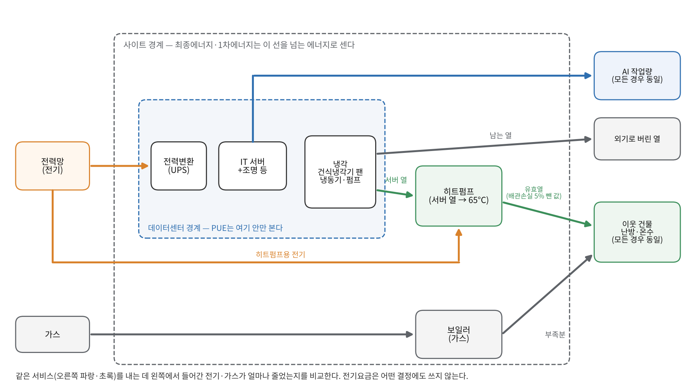
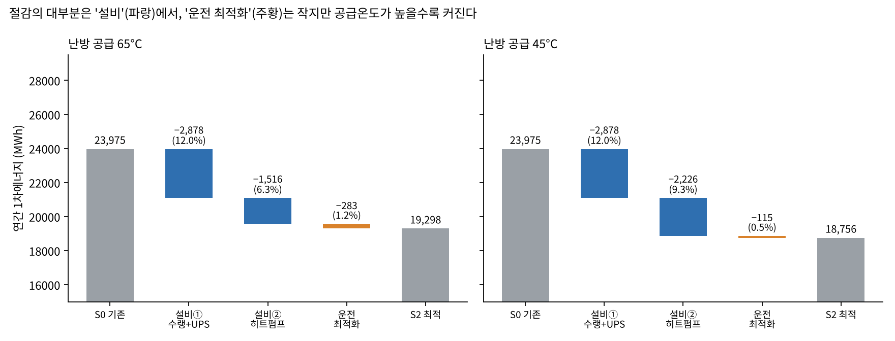
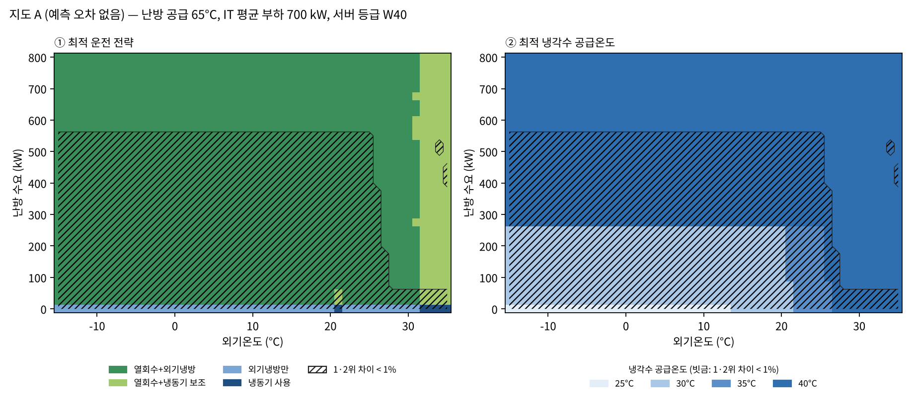
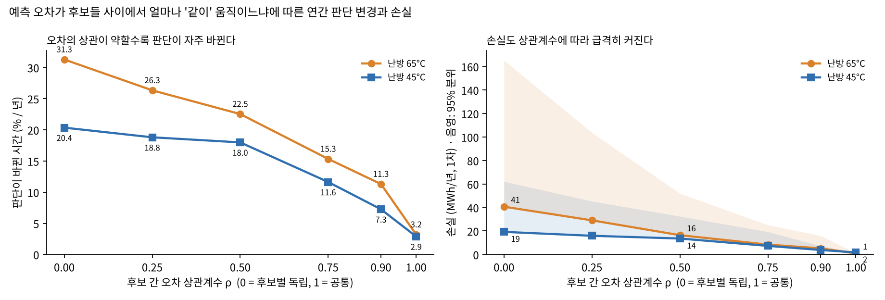

# EnergyFlex — AI 데이터센터의 전력과 열을 함께 보는 에너지 효율 시뮬레이터

> **같은 AI 작업, 같은 난방을 하면서 덜 쓰고 덜 버릴 수 있는가?**

📄 **결과 보고서 (28쪽, 최종 모델 v1.5.2 기준, 비전공자용 설명·수식·한계 포함):** [docs/EnergyFlex_Report_KR.pdf](docs/EnergyFlex_Report_KR.pdf)
🗂 **버전별 변경 기록:** [docs/CHANGELOG.md](docs/CHANGELOG.md)

---

## 1. 바꾸고 싶은 것

AI 데이터센터가 쓰는 전기는 결국 거의 전부 열이 되어 바깥으로 버려집니다. 한쪽에서는 서버 열을 식히려고 전기를 쓰고, 바로 옆 건물은 난방을 위해 가스를 태웁니다.

이 프로젝트의 원칙은 세 가지입니다.

| 원칙 | 의미 |
|---|---|
| **같은 서비스** | 비교하는 모든 경우가 같은 AI 작업량·같은 난방량을 매시간 제공해야 한다 |
| **요금이 아닌 에너지** | 전기가 싸다고 더 쓰는 최적화는 하지 않는다. 판단 기준은 1차에너지(Primary Energy) |
| **분리된 지표** | ESS·수요반응(DR)처럼 '언제 쓰느냐'를 바꾸는 것은 에너지 절감과 섞지 않고 따로 평가 |

## 2. 무엇을 만들었나



- **1년 8,760시간 시뮬레이터:** 1 MW급 AI 연산실 + 이웃 건물 난방·온수
  - 공랭 → 수랭(온수 냉각) → 히트펌프 폐열 회수 → ESS 피크 저감, 4단계 시나리오
- **물리 모델 (v1.3~):**
  - 히트펌프 COP = 열원 출구온도·난방 공급온도·부분부하율의 함수 (외기온도는 직접 쓰지 않음)
  - 펌프 = 정압 + 마찰 + 최소유량 + 효율곡선 (단순 세제곱 법칙 미사용, 실측 성능곡선으로 교체 가능)
  - 건식냉각기 팬·실내 공조기 팬 분리
  - 냉동기 운전 한계(응축 60 °C), 서버 냉각수 허용 등급(ASHRAE W40)
- **실현 가능한 운전 (v1.4):** 동적계획법(Dynamic Programming)으로 설정 변경 폭·유지시간 제약 + 전날 기온 예보 기반 운전
- **최적 운전 지도 (v1.5):** 외기온도 × 난방 수요 × 냉각수 온도별 최적 전략(지도 A)과 예측 오차를 넣은 선택 안정성(지도 B)
- **실측 검증:** NLR(옛 NREL) ESIF 데이터센터 2016~2023년 시간별 데이터
  - 2016~19년으로 보정, 2020~23년으로 검증
  - PUE MAPE 0.9 %
- **자동 보고서:** `python make_report.py --run <esif_hourly.csv>` 한 줄로 시뮬레이션 → 그림 → Word 보고서까지 재생성

## 3. 무엇을 알게 되었나

| 질문 | 결과 (난방 공급 65 °C, v1.5.2) |
|---|---|
| 효율 냉각 + 폐열 회수로 얼마나 줄이나 | 1차에너지 **약 19.5 %** 절감 (근거 범위 안에서 가정을 하나씩 바꿔도 18.6~23.9 %) |
| 절감은 어디서 오나 | 대부분 **설비**에서 옴: 공랭 → 수랭 2,878 MWh, 히트펌프 1,516 MWh, 운전 최적화 283 MWh |
| 운전 최적화는 현실에서도 될까 | 설정 변경 제약 + 예보 오차를 넣어도 이상적 운전 효과의 **95 %** 유지, 주 1회만 바꿔도 87 % |
| 서버 열은 실제로 얼마나 쓰였나 | 발생열의 **38 %**(난방 수요는 100 % 충당): 막힌 곳은 장비가 아니라 열을 쓸 곳(여름 수요 부족) |
| 운전 판단은 예측 오차에 약한가 | 1·2위 차이 1 % 미만인 조건이 59 %지만, 오차를 넣어도 선택이 90 % 이상 유지되는 조건이 93 % |
| 그럼 무엇이 판단을 흔드나 | 오차의 **크기보다 후보들 사이의 상관 구조**. 상관 ρ = 1이면 판단 변경 3 %·손실 1 MWh, ρ = 0.5면 23 %·16 MWh |





## 4. AI와 어떻게 일했나

이 프로젝트는 AI가 없었다면 혼자 해내기 어려웠습니다. 다만 **무엇을 풀지, 무엇을 믿을지는 사람이 정했습니다.**

| 내가 정한 것 | AI가 한 것 | 검토에서 찾아낸 오류 → 수정 |
|---|---|---|
| 문제 정의와 세 가지 원칙(같은 서비스·요금 배제·지표 분리) | 시뮬레이터·물리 모델·최적화 코드 작성 | 냉각기 용량 초과 시간 1,730 h를 정상 처리 → 설계 외기 기준 용량 설계, 초과 0 h |
| 공개 데이터로 검증할 범위를 정하고 명시 | 문헌·표준 검색, 근거 정리 | COP 오차가 열수지와 연결 안 됨 → 시뮬레이터 안에서 재계산 |
| "근거 없는 숫자는 근거를 찾아라" (유휴전력 30 %, 외기 32 °C 등 질문) | 그래프·자동 보고서 생성 | 냉각 전력 오차 후 응축열 미재계산 → 냉동기 COP부터 재계산 |
| 물리적으로 이상한 가정 지적 (펌프 세제곱 법칙, 외기온도 기반 COP) | 민감도·스트레스 테스트 실행 | 요약 집계 버그(0 %로 기록) → 97 %로 수정 |
| 검토 의견 수용 여부와 우선순위 결정 | 수정 구현과 재검증 | '독립 오차 = 최악 상한' 해석 오류 → '스트레스 시나리오'로 정정 |

모든 버전에서 에너지 수지(냉각·열·히트펌프·배관·방열)를 매시간 점검하고, 오차는 10⁻¹³ kW 수준입니다.

## 5. 한계 — 그리고 다음에 필요한 것

| 한계 | 줄이려면 |
|---|---|
| 기상·부하는 서울과 비슷하게 만든 **가상 데이터** | 실제 한국 데이터센터·건물 데이터 |
| v1.3 이후 **상세 설비 모델은 실측으로 보정하지 않음** (ESIF 검증은 간소화 모델 대상) | 히트펌프·냉동기·펌프 실측 성능 데이터 |
| 지도 B의 냉각 오차는 다른 시설의 **대리 불확실성**, COP 오차 ±15 %는 가정 | 실제 예측 모델의 오차와 후보 간 상관 추정 |
| 운전 최적화 효과는 **누설전력 가정**과 **서버 등급**에 크게 좌우됨 (W32면 0) | 서버 사양·칩 온도 데이터, 도메인 전문가 검토 |
| 1인 프로젝트: 검토할 때마다 실제 오류가 나옴 | 동료 검토와 자동 테스트 체계 |

## 실행

```bash
pip install -r requirements.txt
python sim.py && python report.py            # v1.2 기본 시나리오
python sim13.py                               # v1.3+ 물리 모델
python report14.py                            # 스트레스 테스트·실현 가능 운전
# 실측 검증·운전 지도까지: 공개 데이터를 받은 뒤
python download_public_data.py && python prep_esif.py
python make_report.py --run <esif_hourly.csv> # 전체 재실행 + 보고서
```

모든 가정값과 그 근거는 `config.py` 주석([근거] 표시)과 보고서 10장에 있습니다.

## 데이터·문헌

- NLR(옛 NREL) ESIF Data Center 운영 데이터 (공개, CC BY 4.0)
- HEATWISE (Aalborg University) 서버실 환수온도
- ASHRAE 90.1 Appendix G, ASHRAE Thermal Guidelines 5th ed.
- LBNL 2024 US Data Center Energy Usage Report
- Wenzel et al. 2023, Energies; Jensen et al. 2018; Pieper et al. 2020; Chen et al. 2025, Energy 등

전체 목록은 보고서 14장에 있습니다.

---
*MIT License*
